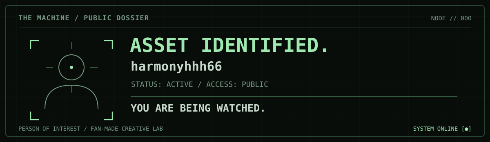
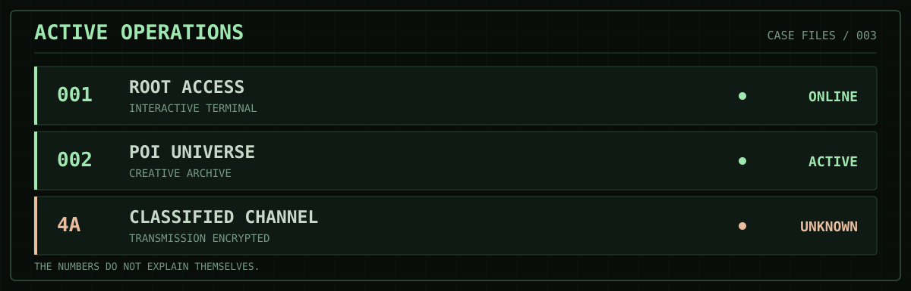
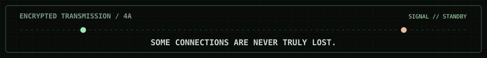

<!-- MISSION 002.5 / MACHINE VISUAL OVERHAUL -->

*Building irrelevant things for reasons that matter.*

[**ENTER THE MACHINE**](https://harmonyhhh66.github.io/poi-universe/) &nbsp; · &nbsp; [**ROOT ACCESS**](https://harmonyhhh66.github.io/poi-universe/projects/root-access/) &nbsp; · &nbsp; [**SOURCE ARCHIVE**](https://github.com/harmonyhhh66/poi-universe)

### `01 // IDENTITY`

I'm exploring **AI agents, human–AI interaction, creative coding, interactive art, and science-fiction ideas** through an unofficial *Person of Interest*-inspired creative lab.

The Machine may be fictional. The projects are real. No actual surveillance is performed.

### `02 // ACTIVE OPERATIONS`

| CASE | OPERATION | OPEN |
|:--|:--|:--|
| `001` | **ROOT ACCESS** · an interactive Machine terminal | [**Launch terminal**](https://harmonyhhh66.github.io/poi-universe/projects/root-access/) |
| `002` | **POI UNIVERSE** · project archive & ideas | [**Enter the library**](https://harmonyhhh66.github.io/poi-universe/) |
| `4A` | **CLASSIFIED CHANNEL** | `connect 4a` inside ROOT ACCESS |

### `03 // RELEVANT RESEARCH`

`AI AGENTS` · `MACHINE MEMORY` · `HUMAN AGENCY` · `CREATIVE TECHNOLOGY` · `INTERACTIVE STORYTELLING`

### `04 // TRANSMISSION`

Unofficial fan-made homage to *Person of Interest*. All identifiers and system messages are fictional. No user tracking or monitoring.

